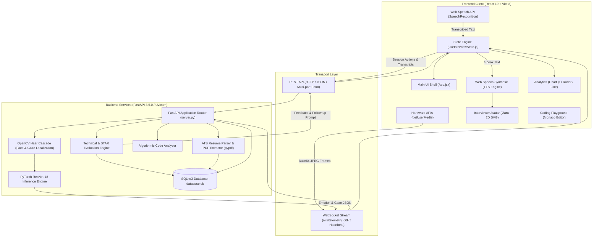
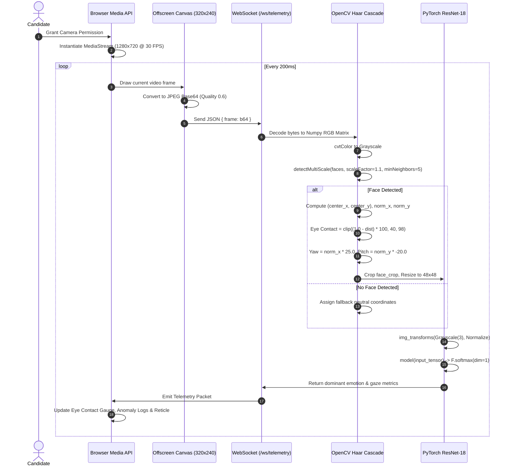

# TalentPulse AI — Architecture & Codebase Brain (`brain.md`)

> **Document Version:** 3.5.0  
> **Target Audience:** Principal Architects, AI Systems Engineers, Full-Stack Developers, QA & DevOps Teams  
> **System Purpose:** High-Throughput Real-Time Cognitive Telemetry, Computer Vision Emotion Inference, Voice-Synthesized Interactive Mock Interviewing & Technical Assessment Platform.

---

## 1. System Overview & Architecture Design

### 1.1 Project Mission & Operational Workflow
**TalentPulse AI** is an enterprise-grade cognitive telemetry and automated mock interview engineering platform. The platform replicates a senior-level technical interview environment through synchronized multimodal telemetry: computer vision gaze and expression tracking, acoustic vocal cadence profiling, automated speech-to-text (STT), text-to-speech (TTS) lip-sync avatar interaction, algorithmic Big-O complexity analysis, and STAR-framework answer evaluations.

```
       Candidate (Browser)
      /                   \
[Webcam Stream]     [Microphone Input]
      |                     |
      v                     v
 [HTML5 Canvas /      [Web Audio API /
 Base64 Frame]       Web Speech API]
      |                     |
      | (WebSocket 60Hz)    | (Interim Transcripts)
      v                     v
[FastAPI Backend]    [Cadence / WPM Analyzer]
      |                     |
      +---------[PyTorch ResNet-18 (FER-2013)]
      |         [OpenCV Haar Cascade Classifier]
      v
[Telemetry Inference Response]
      |
      v
[Client HUD & Telemetry Matrix] ---> [Real-time Dynamic Feedback]
      |
      v
[Session Completion] -------------> [/api/evaluate & /api/evaluate-answer]
                                            |
                                            v
                                [SQLite database.db Persistence]
                                [Diagnostic Scorecard & Visual Analytics]
```

#### Operational Workflow Breakdown:
1. **Question Ingestion & Calibration:**
   - Candidate authenticates and selects a technical track (DSA, Databases & SQL, Backend & Core CS, Web & Frontend, Quantitative Aptitude) or launches a customized interview session.
   - The question prompt is ingested from SQLite/JSON and vocalized via client-side Web Speech Synthesis (`SpeechSynthesisUtterance`), driving real-time 2D SVG viseme oscillations on the interviewer avatar ("Zara").
2. **Audio/Video Telemetry Capture:**
   - `navigator.mediaDevices.getUserMedia` captures 720p/1080p video and raw audio streams.
   - Video frames are sampled every 200ms onto an `OffscreenCanvas` (320x240 JPEG compression) and dispatched across a persistent WebSocket (`ws://127.0.0.1:8000/ws/telemetry`).
   - The microphone stream is tapped by an `AudioContext` `AnalyserNode` (64-point FFT) to gauge live speech volume, conversational turns, and silence pauses.
3. **Speech-to-Text & Vocal Cadence:**
   - The browser's native `SpeechRecognition` / `webkitSpeechRecognition` engine continuously generates interim and final transcript tokens.
   - Dynamic Words-Per-Minute (WPM) calculations track candidate vocal pacing against industry-standard conversational benchmarks (optimal 130–165 WPM).
4. **Model Inference & Telemetry Processing:**
   - The FastAPI server receives frames over WebSockets, decodes JPEG bytes via Pillow and OpenCV, applies Haar Cascade face localization, and crops the facial ROI.
   - The normalized 48x48 3-channel tensor is fed into a fine-tuned PyTorch ResNet-18 model checkpoint (`fer2013_resnet.pth`), producing softmax probabilities across 7 emotion classes (`angry`, `disgust`, `fear`, `happy`, `neutral`, `sad`, `surprise`).
   - Facial bounding box coordinates yield optical gaze deviation (`norm_x`, `norm_y`), head pitch/yaw estimates, and normalized eye contact scores (0–100%).
5. **Real-time UI Telemetry & Dynamic Feedback:**
   - Ingested metrics update the HUD overlay (optical reticles, eye contact percentages, emotion spectrum bars, rolling historical timelines, and anomaly flags).
6. **Post-Answer Evaluation & Adaptive Follow-Up:**
   - Upon answer submission, the transcript is posted to `/api/evaluate-answer` or `/api/evaluate`.
   - The evaluation engine assesses runtime Big-O bounds ($O(N)$, $O(1)$, $O(N \log N)$), memory trade-offs, filler word density, and the STAR framework (Situation, Task, Action, Result).
   - An adaptive follow-up question is generated based on detected omissions or conceptual gaps, maintaining conversational momentum.

---

### 1.2 System Architecture Diagram & Data-Flow Map



---

### 1.3 Key Technical Stack Decisions

| Architectural Domain | Technology Selected | Rationale & Technical Justification |
| :--- | :--- | :--- |
| **Frontend Framework** | **React 19.2.8** | Next-generation React concurrency, transition primitives, fine-grained reconciliation for high-frequency (60 Hz) telemetry updates without frame dropping. |
| **Bundler & Build Tool** | **Vite 8.2.0** | Ultra-fast Hot Module Replacement (HMR), instant ES module bundling, zero-overhead development server with native `@tailwindcss/vite` integration. |
| **Styling & Design System** | **Tailwind CSS v4.3.3 + CSS Custom Properties** | Light glassmorphism aesthetic (`glass-panel`, `glass-pill`, subtle background grid), CSS hardware-accelerated sound-wave keyframes, zero runtime CSS overhead. |
| **Code Editor** | **`@monaco-editor/react` (v4.7.0)** | Production VS Code engine embedded in browser, providing Python and JavaScript syntax highlighting, autocompletion, indentation, and error checking. |
| **Data Visualization** | **Chart.js (v4.5.1) + `react-chartjs-2` (v5.3.1)** | Canvas-accelerated multi-axis line graphs, dynamic radar competency charts, and emotion distribution meters capable of 60 FPS redraws. |
| **Document Synthesis** | **`jspdf` (v4.2.1) + `html2canvas` (v1.4.1)** | Client-side vector and rasterized PDF report generation for post-interview diagnostic assessment sheets and enhanced resumes. |
| **Iconography** | **`lucide-react` (v1.29.0)** | Tree-shakeable, clean SVG icon suite for audio states, camera status, metrics, and navigation tabs. |
| **Linting & Code Quality** | **Oxlint (v1.75.0)** | Rust-based high-performance static analysis tool configured with `react` and `oxc` rules for fast linting passes. |
| **Backend Runtime** | **Python 3.10+ / FastAPI (v3.5.0) + Uvicorn** | Asynchronous ASGI runtime, native WebSocket streaming, Pydantic type validation, and direct in-memory PyTorch tensor execution. |
| **Computer Vision Engine** | **OpenCV (cv2) + Pillow (PIL)** | Haar Cascade frontal face localization, bounding box calculation, optical pitch/yaw angle estimation, and JPEG byte-buffer streaming. |
| **Deep Learning Engine** | **PyTorch (torch / torchvision)** | Fine-tuned ResNet-18 CNN architecture trained on 35,887 FER-2013 facial expression samples, outputting 7-class emotion confidence distributions. |
| **Database Persistence** | **SQLite3 (`database.db`)** | Embedded, zero-configuration ACID relational storage with WAL-mode compatibility, managing users, 50 multi-domain questions, session logs, and resumes. |
| **Document Ingestion** | **`pypdf`** | Low-latency binary PDF text stream extraction for real-time ATS resume keyword cross-referencing and skill gap analysis. |

---

## 2. Directory Structure Map

```
c:/Users/tarde/OneDrive/Desktop/AI_Mock_Interview/
├── .freebuff/                          # Temporary local workspace cache
├── .gitignore                          # Git source control ignore patterns
├── .oxlintrc.json                      # Rust-powered Oxlint configuration
├── README.md                           # Starter repository documentation
├── package.json                        # Node.js project manifest & scripts
├── package-lock.json                   # Deterministic dependency lockfile
├── vite.config.js                      # Vite 8 + React + Tailwind v4 config
├── index.html                          # HTML5 root shell & Google Font links
├── database.db                         # SQLite3 relational database file
├── sessions.json                       # Legacy session dump file
├── server.py                           # FastAPI backend server & ML pipelines
├── train_model.py                      # PyTorch FER-2013 ResNet-18 trainer
├── test_integration.py                 # Full-stack automated integration test
├── fer2013_resnet.pth                  # Trained PyTorch model checkpoint (44.8 MB)
│
├── backend/                            # Backend Data Resources
│   └── questions.json                  # 50 Curated multi-domain interview questions
│
├── dataset/                            # FER-2013 Emotion Training & Validation Data
│   ├── train/                          # 28,709 training images across 7 emotion classes
│   │   ├── angry/                      # Emotion class: Angry
│   │   ├── disgust/                    # Emotion class: Disgust
│   │   ├── fear/                       # Emotion class: Fear
│   │   ├── happy/                      # Emotion class: Happy
│   │   ├── neutral/                    # Emotion class: Neutral
│   │   ├── sad/                        # Emotion class: Sad
│   │   └── surprise/                   # Emotion class: Surprise
│   └── test/                           # 7,178 testing/validation images across 7 classes
│       ├── angry/
│       ├── disgust/
│       ├── fear/
│       ├── happy/
│       ├── neutral/
│       ├── sad/
│       └── surprise/
│
├── dist/                               # Production compilation output directory
│
├── public/                             # Static Web Assets
│   ├── favicon.svg                     # SVG Brand Favicon
│   └── icons.svg                       # Social & documentation SVG symbol sprites
│
└── src/                                # Frontend Application Source
    ├── main.jsx                        # React root entry point
    ├── App.jsx                         # Root application state & tab coordinator
    ├── index.css                       # Tailwind directives, CSS variables & animations
    ├── App.css                         # Legacy CSS layout rules
    │
    ├── assets/                         # Static UI Graphic Assets
    │   ├── hero.png                    # Brand hero graphic
    │   ├── react.svg                   # React brand logo
    │   └── vite.svg                    # Vite brand logo
    │
    ├── data/                           # Client Static Datasets
    │   └── questions.json              # Bundled client question fallback dataset
    │
    ├── hooks/                          # Custom React Hooks
    │   └── useInterviewState.js        # Comprehensive global state machine & WS engine
    │
    └── components/                     # Modular React Components
        ├── Navbar.jsx                  # Top navigation bar, tab selector & user profile
        ├── InterviewRoom.jsx           # Main interactive room: camera, Zara, questions
        ├── LiveRecordingView.jsx       # Alternative/legacy HUD recording viewport
        ├── ZaraAvatar.jsx              # Vector SVG 2D lip-syncing interviewer avatar
        ├── TelemetryPanel.jsx          # Collapsible 60Hz live telemetry matrix drawer
        ├── AssessmentDrawer.jsx        # Post-session modal scorecard with export options
        ├── CodingPlayground.jsx        # Monaco code editor with LeetCode problems & AI review
        ├── QuestionBank.jsx            # 5-Domain question browser, search & track selector
        ├── PerformanceDashboard.jsx    # Radar charts, emotion timeline & STAR breakdown
        ├── ResumeATSBuilder.jsx        # Resume editor, PDF parser & ATS keyword matcher
        ├── AuthPage.jsx                # Light glassmorphic sign-in & sign-up screen
        ├── OAuthModal.jsx              # Google/GitHub OAuth 2.0 simulation modal
        ├── DevWebSocketModal.jsx       # Python client script & JSON schema integration modal
        └── DiagnosticReport.jsx        # Comprehensive question-by-question review page
```

---

## 3. Comprehensive File-by-File Ledger

### Root Configuration & Operational Files

#### `package.json`
- **Primary Responsibility:** Node.js package manifest defining project metadata, build lifecycle scripts, and production/development dependencies.
- **Key Exports / Components / Functions:** Scripts: `dev` (`vite --host 127.0.0.1 --port 5173`), `build` (`vite build`), `lint` (`oxlint`), `preview` (`vite preview`).
- **Core Code Logic & Implementation Details:** Explicitly locks dependencies to modern versions: React 19 (`^19.2.8`), Tailwind CSS v4 (`^4.3.3`), Vite 8 (`^8.2.0`), Monaco Editor (`^4.7.0`), Chart.js (`^4.5.1`), and document synthesis tools (`jspdf`, `html2canvas`, `html2pdf.js`).
- **Dependencies & Interconnections:** Consumed by Node.js, Vite bundler, and NPM package manager. Controls package resolution across all `.jsx` components.
- **Data Flow / Telemetry Role:** Establishes build dependencies required to compile telemetry visualizers and runtime canvas charts.

#### `package-lock.json`
- **Primary Responsibility:** Immutable, fully-resolved dependency tree lockfile ensuring deterministic installs across deployment targets.
- **Key Exports / Components / Functions:** N/A (Dependency resolution tree).
- **Core Code Logic & Implementation Details:** Pins exact SHA-512 hashes and versions for all 100+ indirect node module dependencies.
- **Dependencies & Interconnections:** Managed by `npm install`.
- **Data Flow / Telemetry Role:** Build integrity enforcement.

#### `vite.config.js`
- **Primary Responsibility:** Vite bundler configuration file configuring build plugins and asset pipelines.
- **Key Exports / Components / Functions:** `default defineConfig({ plugins: [react(), tailwindcss()] })`.
- **Core Code Logic & Implementation Details:** Integrates `@vitejs/plugin-react` for JSX transformation with Fast Refresh, and `@tailwindcss/vite` for Tailwind CSS v4 compilation without requiring a separate `postcss.config.js` or `tailwind.config.js`.
- **Dependencies & Interconnections:** Imports `defineConfig` from `vite`, `react` from `@vitejs/plugin-react`, and `tailwindcss` from `@tailwindcss/vite`.
- **Data Flow / Telemetry Role:** Enables hot-module replacement (HMR) for instant development iteration on telemetry components.

#### `index.html`
- **Primary Responsibility:** Single-page application HTML5 entry point and web font loader.
- **Key Exports / Components / Functions:** Mount node `<div id="root"></div>`, module script inclusion `<script type="module" src="/src/main.jsx"></script>`.
- **Core Code Logic & Implementation Details:** Preconnects to Google Fonts CDN (`fonts.googleapis.com`, `fonts.gstatic.com`) and asynchronously downloads high-legibility typography: `Plus Jakarta Sans` (body and headings), `JetBrains Mono` (technical metrics and code badges), `Orbitron` (high-tech indicators), and `Outfit`. Sets global background styles (`bg-[#F8FAFC]`) and custom selection colors.
- **Dependencies & Interconnections:** Root host for `src/main.jsx`.
- **Data Flow / Telemetry Role:** Establishes the viewport bounds and typography engines used by the live telemetry heads-up displays.

#### `.oxlintrc.json`
- **Primary Responsibility:** High-speed linter configuration enforcing React hooks correctness and module conventions.
- **Key Exports / Components / Functions:** Rule declarations: `"react/rules-of-hooks": "error"`, `"react/only-export-components": ["warn", { "allowConstantExport": true }]`.
- **Core Code Logic & Implementation Details:** Configures Oxlint with React and OXC plugins according to schema definition.
- **Dependencies & Interconnections:** Consumed by `npm run lint`.
- **Data Flow / Telemetry Role:** Prevents React hook lifecycle memory leaks in complex streaming components (`InterviewRoom`, `useInterviewState`).

#### `.gitignore`
- **Primary Responsibility:** Specifies untracked files and artifacts to ignore in Git version control.
- **Key Exports / Components / Functions:** Patterns ignoring `node_modules`, `dist`, `.env`, `.DS_Store`, build logs, and Python cache directories.
- **Core Code Logic & Implementation Details:** Standard clean gitignore rules.
- **Dependencies & Interconnections:** Git CLI.
- **Data Flow / Telemetry Role:** Excludes bulky local builds and SQLite database checkpoints from repository pollution.

#### `README.md`
- **Primary Responsibility:** Default developer quick-start notes and Vite template documentation.
- **Key Exports / Components / Functions:** Markdown documentation.
- **Core Code Logic & Implementation Details:** Standard template notes on React compiler and Oxlint usage.
- **Dependencies & Interconnections:** N/A.
- **Data Flow / Telemetry Role:** Developer orientation.

#### `server.py`
- **Primary Responsibility:** FastAPI backend server providing real-time WebSocket telemetry, PyTorch ResNet-18 emotion inference, OpenCV facial geometry parsing, SQLite persistence, and question/evaluator endpoints.
- **Key Exports / Components / Functions:**
  - `app`: Main FastAPI instance (v3.5.0) with CORS middleware.
  - `init_sqlite_db()`: Initializes tables (`users`, `questions`, `interview_sessions`, `resumes`) and seeds 50 multi-domain questions.
  - `load_resnet_model()`: Instantiates PyTorch ResNet-18 model, replaces final fully connected layer for 7 classes, loads `fer2013_resnet.pth`, and maps to GPU/CPU.
  - `process_frame_and_predict(image_bytes)`: Executes OpenCV Haar Cascade face detection, crop extraction, tensor transformations, PyTorch forward pass, and gaze geometry estimation.
  - `websocket_telemetry_endpoint(websocket)`: WebSocket router on `/ws/telemetry` and `/ws/interview` handling 60Hz streaming and frame processing.
  - Endpoints:
    - `GET /`: Health check and system database counters.
    - `POST /api/auth/sync`: Syncs candidate profile to SQLite `users` table.
    - `GET /api/questions`: Query questions with domain, role, difficulty, and search filters.
    - `POST /api/evaluate-answer`: Evaluates runtime/space Big-O bounds and generates follow-ups.
    - `POST /api/evaluate` / `POST /api/feedback`: STAR rubric scoring, filler word analyzer, and metric generation.
    - `POST /api/sessions/save`: Persists completed session payloads into SQLite.
    - `GET /api/sessions/latest`: Retrieves latest interview session for report dashboards.
    - `GET /api/sessions`: Returns list of past recorded sessions.
    - `POST /api/follow-up`: Generates domain-specific adaptive follow-up questions.
    - `POST /api/code/review`: Algorithmic review of candidate Monaco code.
    - `POST /api/resume/cross-check`: ATS keyword cross-matching and pypdf text extraction.
    - `POST /api/resume/enhance`: Generates enhanced ATS-optimized summaries and action bullets.
- **Core Code Logic & Implementation Details:**
  - Uses `cv2.CascadeClassifier` with `haarcascade_frontalface_default.xml` to detect faces. Calculates normalized center offsets:
    $$\text{norm\_x} = \frac{\text{center\_x} - \frac{W}{2}}{\frac{W}{2}}, \quad \text{norm\_y} = \frac{\text{center\_y} - \frac{H}{2}}{\frac{H}{2}}$$
  - Computes eye contact score: $\text{score} = \text{clip}((1.0 - \sqrt{\text{norm\_x}^2 + \text{norm\_y}^2}) \times 100, 40, 98)$.
  - Preprocesses face crop to $48 \times 48$, 3-channel grayscale, normalized by ImageNet mean and std, passed through ResNet-18 with `torch.no_grad()`.
- **Dependencies & Interconnections:** Imports `torch`, `torchvision`, `cv2`, `PIL`, `fastapi`, `sqlite3`, `pypdf`, `numpy`. Serves the entire React frontend.
- **Data Flow / Telemetry Role:** Core backend telemetry engine receiving raw video frames and outputting cognitive metrics.

#### `train_model.py`
- **Primary Responsibility:** PyTorch training and evaluation script to fine-tune a ResNet-18 classifier on the FER-2013 dataset.
- **Key Exports / Components / Functions:**
  - `main()`: Orchestrates dataset loading, data augmentation, model configuration, training loops, evaluation passes, and model checkpoint serialization.
- **Core Code Logic & Implementation Details:**
  - Configures `transforms.Compose`: Grayscale to 3-channel tensor, resizing to $(48, 48)$, random horizontal flips, $\pm 10^\circ$ random rotations, and tensor normalization.
  - Loads data from `dataset/train` and `dataset/test` via `datasets.ImageFolder` and `DataLoader` (batch size 64).
  - Instantiates `models.resnet18(weights=DEFAULT)`, modifies `model.fc = nn.Linear(in_features, 7)`.
  - Employs `nn.CrossEntropyLoss()`, `optim.Adam(lr=1e-3)`, and `StepLR(step_size=2, gamma=0.5)`.
  - Saves the resulting weights dictionary directly to `fer2013_resnet.pth`.
- **Dependencies & Interconnections:** Depends on PyTorch and `dataset/`. Produces `fer2013_resnet.pth` which is loaded by `server.py`.
- **Data Flow / Telemetry Role:** Model training pipeline that provides the weights for facial emotion classification.

#### `test_integration.py`
- **Primary Responsibility:** Automated end-to-end integration test suite verifying backend REST routes, SQLite queries, and WebSocket streaming.
- **Key Exports / Components / Functions:**
  - `test_all()`: Asynchronous test routine executed via `asyncio.run()`.
- **Core Code Logic & Implementation Details:**
  - Tests 9 distinct integration points:
    1. Vite frontend HTTP 200 response on `http://127.0.0.1:5173/`.
    2. FastAPI root status and SQLite stats on `http://127.0.0.1:8000/`.
    3. User profile persistence via `POST /api/auth/sync`.
    4. Multi-domain question retrieval and query filtering via `GET /api/questions`.
    5. Transcript evaluation, filler word parsing, and STAR scoring via `POST /api/evaluate`.
    6. Session save and read-back via `POST /api/sessions/save` and `GET /api/sessions/latest`.
    7. Adaptive follow-up question generation via `POST /api/follow-up`.
    8. Big-O Monaco code review via `POST /api/code/review`.
    9. WebSocket telemetry streaming handshake and JSON frame delivery on `ws://127.0.0.1:8000/ws/telemetry`.
- **Dependencies & Interconnections:** Uses `urllib.request`, `json`, `asyncio`, and `websockets` to validate `server.py`.
- **Data Flow / Telemetry Role:** Quality assurance verification verifying that all API contracts and telemetry pipelines are operational.

#### `fer2013_resnet.pth`
- **Primary Responsibility:** Binary model weights checkpoint for the fine-tuned ResNet-18 facial expression classifier (44,798,795 bytes).
- **Key Exports / Components / Functions:** PyTorch serialized `state_dict`.
- **Core Code Logic & Implementation Details:** Contains trained weight and bias tensors for all convolution layers, residual blocks, batch normalization layers, and the modified 7-class linear classification head.
- **Dependencies & Interconnections:** Loaded by `server.py:load_resnet_model()` at application startup.
- **Data Flow / Telemetry Role:** Directly powers facial emotion inference during live candidate interview sessions.

#### `sessions.json`
- **Primary Responsibility:** JSON storage file maintaining legacy interview session records.
- **Key Exports / Components / Functions:** JSON array containing session summary objects.
- **Core Code Logic & Implementation Details:** Stores `id`, `transcript`, `duration_seconds`, `final_score`, `dominant_emotion`, `avg_eye_contact`, `avg_wpm`, and `created_at`.
- **Dependencies & Interconnections:** Historical fallback for session logs.
- **Data Flow / Telemetry Role:** Records session telemetry for post-interview analysis.

#### `database.db`
- **Primary Responsibility:** SQLite3 relational database file storing production application state.
- **Key Exports / Components / Functions:** SQLite database file with tables: `users`, `questions`, `interview_sessions`, `resumes`.
- **Core Code Logic & Implementation Details:** Managed via `sqlite3` in `server.py`. Contains 50 seeded multi-domain questions and persisted candidate transcripts and radar metrics.
- **Dependencies & Interconnections:** Queried by `server.py` across all `/api/*` endpoints.
- **Data Flow / Telemetry Role:** Persistent relational storage for candidate telemetry, interview transcripts, and diagnostic reports.

---

### Backend Data

#### `backend/questions.json`
- **Primary Responsibility:** Master repository of 50 curated technical interview questions across 5 core engineering domains.
- **Key Exports / Components / Functions:** JSON array containing 50 question schema objects.
- **Core Code Logic & Implementation Details:** Each entry adheres to the schema:
  - `id` (integer)
  - `domain` ('DSA & Algorithms', 'Database Systems & SQL', 'Backend & Core CS', 'Web & Frontend', 'Quantitative & Logical Aptitude')
  - `category` (e.g. 'Two Pointers & Arrays', 'ACID Transactions', 'Event Loop & Concurrency')
  - `role` ('Full-Stack', 'Frontend', 'Backend', 'DevOps', 'General')
  - `difficulty` ('Easy', 'Medium', 'Hard')
  - `estimatedDuration` & `targetDurationSec`
  - `title` & `prompt`
  - `skillsAssessed` (array of string keywords)
  - `modelAnswerTip` (reference technical expectations, including Big-O bounds)
- **Dependencies & Interconnections:** Seeded into SQLite by `server.py:init_sqlite_db()`.
- **Data Flow / Telemetry Role:** Provides the technical prompts vocalized by Zara and evaluated by the AI engine.

---

### Dataset Directory

#### `dataset/train/` & `dataset/test/`
- **Primary Responsibility:** Facial Expression Recognition (FER-2013) dataset divided into training and testing partitions.
- **Key Exports / Components / Functions:** 35,887 grayscale $48 \times 48$ JPEG/PNG images categorized into 7 subdirectories:
  - `angry/`
  - `disgust/`
  - `fear/`
  - `happy/`
  - `neutral/`
  - `sad/`
  - `surprise/`
- **Core Code Logic & Implementation Details:** Used by PyTorch's `ImageFolder` to train the ResNet-18 model in `train_model.py`.
- **Dependencies & Interconnections:** Consumed by `train_model.py`.
- **Data Flow / Telemetry Role:** Training ground truth for facial emotion inference.

---

### Public Static Assets

#### `public/favicon.svg`
- **Primary Responsibility:** Application brand favicon icon displayed in browser tabs.
- **Key Exports / Components / Functions:** Scalable SVG asset featuring brand gradient and geometric emblem.
- **Core Code Logic & Implementation Details:** Inline SVG with color stops and clipping masks.
- **Dependencies & Interconnections:** Linked in `index.html`.
- **Data Flow / Telemetry Role:** Visual branding.

#### `public/icons.svg`
- **Primary Responsibility:** Vector sprite collection providing SVG symbol definitions.
- **Key Exports / Components / Functions:** `<symbol>` definitions for `bluesky-icon`, `discord-icon`, `documentation-icon`, `github-icon`, `social-icon`, `x-icon`.
- **Core Code Logic & Implementation Details:** Reusable SVG sprite referenced via `<use href="/icons.svg#icon-id" />`.
- **Dependencies & Interconnections:** Used across UI layouts and documentation links.
- **Data Flow / Telemetry Role:** UI icon rendering.

---

### Frontend Core & Styles

#### `src/main.jsx`
- **Primary Responsibility:** React application entry point mounting the component tree into the DOM root.
- **Key Exports / Components / Functions:** Root render invocation: `createRoot(document.getElementById('root')).render(...)`.
- **Core Code Logic & Implementation Details:** Wraps `App` in React 19 `StrictMode` to identify side-effects and deprecated lifecycles. Imports `index.css`.
- **Dependencies & Interconnections:** Imports `createRoot` from `react-dom/client`, `App` from `./App.jsx`, and `./index.css`.
- **Data Flow / Telemetry Role:** Initiates top-level React rendering.

#### `src/App.jsx`
- **Primary Responsibility:** Top-level application coordinator managing active tab routing, user authentication state, global notifications, and telemetry drawers.
- **Key Exports / Components / Functions:** `App` (default export).
- **Core Code Logic & Implementation Details:**
  - Manages `user` profile state from `localStorage.getItem('talentpulse_user')`. If `user` is null, renders `AuthPage`.
  - Destructures state machine methods from `useInterviewState()`: `activeTab`, `setActiveTab`, `connectionMode`, `wsStatus`, `liveMetrics`, `isRecording`, `startSession`, `endAndAnalyze`, etc.
  - Dynamically renders active tab component based on `activeTab` value:
    - `'interview'`: `<InterviewRoom />`
    - `'coding'`: `<CodingPlayground />`
    - `'analytics'`: `<PerformanceDashboard />`
    - `'questions'`: `<QuestionBank />`
    - `'resume'`: `<ResumeATSBuilder />`
    - `'report'`: `<DiagnosticReport />`
  - Mounts persistent `<Navbar />`, collapsible `<TelemetryPanel />`, and `<DevWebSocketModal />`.
- **Dependencies & Interconnections:** Imports components (`Navbar`, `AuthPage`, `InterviewRoom`, `CodingPlayground`, `PerformanceDashboard`, `QuestionBank`, `ResumeATSBuilder`, `DiagnosticReport`, `TelemetryPanel`, `DevWebSocketModal`) and `useInterviewState`.
- **Data Flow / Telemetry Role:** Primary state and layout hub routing live telemetry feeds between panels and pages.

#### `src/index.css`
- **Primary Responsibility:** Global CSS style sheet defining Tailwind v4 layers, custom design tokens, typography utility classes, scrollbars, and keyframe animations.
- **Key Exports / Components / Functions:**
  - CSS variables: `--bg-main` (`#F8FAFC`), `--bg-card` (`#FFFFFF`), `--indigo-accent` (`#4F46E5`), etc.
  - Custom classes: `.glass-panel`, `.glass-panel-solid`, `.glass-card-interactive`, `.glass-navbar`, `.glass-pill`, `.glass-input`, `.bg-subtle-grid`.
  - Sound-wave keyframe animations: `@keyframes soundwave-speaking`, `@keyframes soundwave-listening`, `.animate-wave-speak-[1-5]`, `.animate-wave-listen-[1-5]`.
- **Core Code Logic & Implementation Details:** Defines micro-animations with staggered animation delays (`0.05s` to `0.2s`) to emulate natural vocal frequencies on the Zara avatar indicator.
- **Dependencies & Interconnections:** Imported in `main.jsx`; applied across all components.
- **Data Flow / Telemetry Role:** Provides the styling and animation infrastructure for telemetry components.

#### `src/App.css`
- **Primary Responsibility:** Legacy template style definitions and responsive utilities.
- **Key Exports / Components / Functions:** `.hero`, `#center`, `#next-steps`, `.ticks`.
- **Core Code Logic & Implementation Details:** Custom layout and perspective transform definitions.
- **Dependencies & Interconnections:** Maintained for CSS backwards compatibility.
- **Data Flow / Telemetry Role:** N/A.

#### `src/assets/hero.png`, `react.svg`, `vite.svg`
- **Primary Responsibility:** Static image assets and framework logos.
- **Key Exports / Components / Functions:** Binary PNG and SVG images.
- **Core Code Logic & Implementation Details:** Static imagery used in documentation, headers, and UI cards.
- **Dependencies & Interconnections:** Imported in template views.
- **Data Flow / Telemetry Role:** Static visual rendering.

---

### Frontend Static Data

#### `src/data/questions.json`
- **Primary Responsibility:** Client-side bundled fallback dataset containing all 50 multi-domain questions.
- **Key Exports / Components / Functions:** JSON array of question objects (mirrors `backend/questions.json`).
- **Core Code Logic & Implementation Details:** Imported statically by `useInterviewState.js` as an immediate offline fallback if the FastAPI server is unreachable.
- **Dependencies & Interconnections:** Imported by `useInterviewState.js`.
- **Data Flow / Telemetry Role:** Guarantees that question cards and interview rounds function even during offline operation.

---

### Frontend Custom Hooks

#### `src/hooks/useInterviewState.js`
- **Primary Responsibility:** Core interview state engine managing active sessions, WebSocket connections, Web Speech STT, simulation ticks, telemetry persistence, and evaluation pipelines.
- **Key Exports / Components / Functions:**
  - `INITIAL_QUESTION_BANK`: Loaded from `src/data/questions.json`.
  - `useInterviewState()`: Primary hook returning all interview states, metrics, and controller actions.
  - State variables: `activeTab`, `connectionMode`, `wsStatus`, `liveMetrics`, `telemetryHistory`, `anomalyLogs`, `transcript`, `resumeData`, `finalAssessment`, `currentQuestion`, `sessionTime`.
  - Handler functions: `startSession()`, `pauseSession()`, `nextQuestion()`, `selectQuestionAndStart()`, `endAndAnalyze()`, `connectWebSocket()`, `pushTelemetryPoint()`, `autoFixResumeWithAI()`.
- **Core Code Logic & Implementation Details:**
  - Auto-connects to WebSocket on mount (`ws://127.0.0.1:8000/ws/telemetry`).
  - Initializes Web Speech Recognition (`window.SpeechRecognition || window.webkitSpeechRecognition`) with `continuous = true` and `interimResults = true`, appending transcribed speech tokens to state.
  - Incorporates built-in fallback simulation engine (`setInterval` 1000ms) generating realistic gaze and WPM telemetry when WebSocket mode is disconnected.
  - Mounts `window.CognitiveLab` onto the global window object, providing external JS hooks (`sendFrame`, `pushTelemetry`, `getState`) for automated benchmarking.
  - Implements `endAndAnalyze()` which averages eye contact and WPM, submits transcripts to `/api/evaluate`, parses the returned STAR rubric, saves to `/api/sessions/save`, and caches the session in `localStorage`.
- **Dependencies & Interconnections:** Imports `useState`, `useEffect`, `useRef`, `useCallback` from `react`; imports `src/data/questions.json`. Consumed directly by `App.jsx`.
- **Data Flow / Telemetry Role:** The operational core of the client application, coordinating telemetry ingestion and evaluation dispatch.

---

### Frontend Components Ledger

#### `src/components/Navbar.jsx`
- **Primary Responsibility:** Top navigation bar displaying brand identity, segmented primary navigation pills, secondary dropdown menus, recording indicators, and candidate profile management.
- **Key Exports / Components / Functions:** `Navbar` (default export).
- **Core Code Logic & Implementation Details:**
  - Segmented control rendering primary tabs (`Practice Room`, `Live Coding`, `Analytics`) with live recording pulse dots.
  - Dropdown menu ("More") containing secondary routes: `Question Bank`, `Resume Builder`, `Diagnostic Report`.
  - Profile dropdown presenting user details, role, seniority badge, and sign-out action.
- **Dependencies & Interconnections:** Imports Lucide icons (`Video`, `Terminal`, `BarChart3`, `BookOpen`, `FileText`, `Award`, `Bot`, `LogOut`, `ChevronDown`). Used in `App.jsx`.
- **Data Flow / Telemetry Role:** Displays live recording status indicator.

#### `src/components/InterviewRoom.jsx`
- **Primary Responsibility:** Main interactive interview room orchestrating the question card, candidate video viewport, optical focus canvas, Zara interviewer card, live metrics summary, and session action bar.
- **Key Exports / Components / Functions:**
  - `ComplexityChip`: Formatted chip rendering Big-O complexity strings with satisfied/omitted status badges.
  - `FormattedGuidance`: Regex parser detecting and highlighting Big-O expressions (e.g. $O(N)$, $O(1)$) in model tips.
  - `InterviewRoom` (default export).
- **Core Code Logic & Implementation Details:**
  - Requests camera/microphone via `navigator.mediaDevices.getUserMedia`. Attaches stream to HTML5 `<video ref={videoRef}>` with `-scale-x-100` mirror transform.
  - Integrates Web Audio API `AudioContext` and `AnalyserNode` to compute `liveVolumeLevel` and animate visualizer bars.
  - Runs animated eye focus reticle loop on `<canvas ref={canvasRef}>` overlay.
  - Speech synthesis controller (`speakText`) utilizing `window.speechSynthesis` and natural English voice selection to vocalize prompts.
  - Manages `handleSubmitAnswer()`, which posts transcript and rubric parameters to `/api/evaluate-answer`, receives complexity checks, updates state, and plays vocalized follow-up prompts.
- **Dependencies & Interconnections:** Imports `ZaraAvatar`, Lucide icons. Rendered by `App.jsx` under `'interview'` tab.
- **Data Flow / Telemetry Role:** Central hardware interface coordinating candidate video/audio streams, AI speech, and answer submission.

#### `src/components/LiveRecordingView.jsx`
- **Primary Responsibility:** Specialized/alternative interview viewport featuring a dark cybernetic heads-up display (HUD), animated facial mesh wireframes, and periodic JPEG frame extraction.
- **Key Exports / Components / Functions:** `LiveRecordingView` (default export).
- **Core Code Logic & Implementation Details:**
  - Contains an `OffscreenCanvas` interval loop extracting 320x240 JPEG frames every 200ms and dispatching them via `window.CognitiveLab.sendFrame(b64)`.
  - Canvas 2D animation loop drawing animated facial landmarks: bounding boxes, eye tracking crosshairs, gaze lines to camera optical center, mouth tracking arcs, and wireframe mesh nodes.
  - Gauge visualizer SVG rendering circular eye contact percentage dials.
- **Dependencies & Interconnections:** Imports Lucide icons. Can be swapped with `InterviewRoom` or used in testing modes.
- **Data Flow / Telemetry Role:** Client-side video frame sampling engine delivering base64 payloads to the backend PyTorch server.

#### `src/components/ZaraAvatar.jsx`
- **Primary Responsibility:** 2D vector SVG interviewer avatar ("Zara") featuring lip-synced mouth phonemes, procedural eye blinks, natural head tilts, and dynamic acoustic wave indicators.
- **Key Exports / Components / Functions:** `ZaraAvatar` (default export).
- **Core Code Logic & Implementation Details:**
  - Lip-sync engine: When `isSpeaking` is true, an animated `requestAnimationFrame` loop cycles through viseme states (`open_wide`, `open_teeth`, `open_round`, `closed`) every 95ms, altering SVG mouth paths (`renderMouth()`).
  - Eye blinking: A stochastic timer triggers blinks every 2.5–5.5 seconds, closing eye paths for 160ms.
  - Sound wave indicator: Displays dynamic animated waves for `'speaking'` (indigo), `'listening'` (emerald), `'analyzing'` (amber), and `'ready'` (slate).
  - Speech bubble box displaying adaptive follow-up prompts from Zara.
- **Dependencies & Interconnections:** Rendered inside `InterviewRoom.jsx`.
- **Data Flow / Telemetry Role:** Visual and acoustic representation of the AI interviewer responding to speech events.

#### `src/components/TelemetryPanel.jsx`
- **Primary Responsibility:** Collapsible 60Hz real-time telemetry matrix sidebar displaying emotion distributions, rolling fluctuation charts, and anomaly event logs.
- **Key Exports / Components / Functions:** `TelemetryPanel` (default export).
- **Core Code Logic & Implementation Details:**
  - Chart.js Line chart rendering rolling 30-second window of eye contact %, confidence %, and nervousness %.
  - Live emotion progress bars for Neutral, Confident/Happy, Nervous/Fear, and Surprised.
  - Chronological anomaly event feed logging micro-expression spikes, head tilt shifts, and eye gaze lock events.
  - Smooth collapsible sidebar with expand/collapse toggle buttons.
- **Dependencies & Interconnections:** Imports `react-chartjs-2`, `chart.js`, Lucide icons. Mounted in `App.jsx`.
- **Data Flow / Telemetry Role:** Real-time data visualization dashboard reflecting live inference results.

#### `src/components/AssessmentDrawer.jsx`
- **Primary Responsibility:** Post-interview diagnostic assessment drawer presenting comprehensive scores, verbal delivery evaluations, facial demeanor analyses, and JSON export capabilities.
- **Key Exports / Components / Functions:** `AssessmentDrawer` (default export).
- **Core Code Logic & Implementation Details:**
  - Tabbed interface switching between Verbal Delivery, Facial Expression & Gaze, and Technical/STAR Feedback.
  - Highlights overall scores (0–100) and readiness ratings (e.g. `EXCEPTIONAL // SENIOR CAPABLE`).
  - Implements `handleDownloadJSON()` generating data-URI blobs for local file download.
  - Implements `handleCopyReport()` writing formatted summary text to clipboard via `navigator.clipboard`.
- **Dependencies & Interconnections:** Imports Lucide icons. Opened upon session completion.
- **Data Flow / Telemetry Role:** Post-session analytics viewer and export tool.

#### `src/components/CodingPlayground.jsx`
- **Primary Responsibility:** Integrated coding environment hosting Monaco Editor, multi-language support (Python, JavaScript), LeetCode-style problem descriptions, and automated Big-O AI code reviews.
- **Key Exports / Components / Functions:**
  - `CODING_PROBLEMS`: Problem bank including Two Sum, Valid Parentheses, Longest Substring Without Repeating Characters, and Binary Search.
  - `CodingPlayground` (default export).
- **Core Code Logic & Implementation Details:**
  - Integrates `@monaco-editor/react` configured with VS Code dark/light themes, automatic layout scaling, and tab settings.
  - Simulated code execution runner evaluating test cases with execution runtimes.
  - Submits code to `POST /api/code/review` to perform algorithmic AST/keyword analysis and obtain Big-O runtime, space complexity, correctness score, and optimization tips.
- **Dependencies & Interconnections:** Imports `@monaco-editor/react`, Lucide icons. Rendered by `App.jsx` under `'coding'` tab.
- **Data Flow / Telemetry Role:** Evaluates candidate code and algorithmic complexity.

#### `src/components/QuestionBank.jsx`
- **Primary Responsibility:** Multi-domain technical question repository browser enabling searching, category filtering, difficulty selection, and instant session launch.
- **Key Exports / Components / Functions:** `QuestionBank` (default export).
- **Core Code Logic & Implementation Details:**
  - Domain filter tabs: DSA & Algorithms, Database Systems & SQL, Backend & Core CS, Web & Frontend, Quantitative & Logical Aptitude.
  - Search input filtering across question titles, prompts, categories, and assessed skill tags.
  - Difficulty pill filters (Easy, Medium, Hard).
  - "Practice Question" button triggering `onSelectQuestion(q)`, updating current question index, and launching an interview session.
- **Dependencies & Interconnections:** Imports Lucide icons. Rendered by `App.jsx` under `'questions'` tab.
- **Data Flow / Telemetry Role:** Interface for selecting question parameters to evaluate in interview rounds.

#### `src/components/PerformanceDashboard.jsx`
- **Primary Responsibility:** Comprehensive analytics dashboard displaying multi-axis radar competency charts, temporal emotion fluctuation graphs, and STAR framework scorecards.
- **Key Exports / Components / Functions:** `PerformanceDashboard` (default export).
- **Core Code Logic & Implementation Details:**
  - Chart.js Radar chart contrasting candidate scores (Technical Skills, Soft Skills, Body Language, STAR Structure) against senior industry benchmarks.
  - Multi-line temporal timeline displaying confidence %, eye contact %, and nervousness fluctuations over time.
  - STAR rubric breakdown (Situation, Task, Action, Result) with sub-scores.
  - Filler word tracker displaying total counts, breakdown metrics, and density percentages.
- **Dependencies & Interconnections:** Imports `react-chartjs-2`, `chart.js`, Lucide icons. Rendered by `App.jsx` under `'analytics'` tab.
- **Data Flow / Telemetry Role:** Consolidates all session telemetry and evaluation scores into visual performance metrics.

#### `src/components/ResumeATSBuilder.jsx`
- **Primary Responsibility:** Resume editor, PDF parser, and AI ATS matcher cross-referencing candidate resumes against target job descriptions.
- **Key Exports / Components / Functions:** `ResumeATSBuilder` (default export).
- **Core Code Logic & Implementation Details:**
  - File drag-and-drop / upload handler dispatching files to `POST /api/resume/cross-check`.
  - ATS keyword matcher identifying matched and missing skills against job descriptions.
  - "Auto-Fix with AI" action querying `POST /api/resume/enhance` to rewrite bullet points using strong action verbs and metrics.
  - PDF export engine utilizing `html2canvas` and `jspdf` to convert the live resume preview DOM element into an A4 PDF document.
- **Dependencies & Interconnections:** Imports `jspdf`, `html2canvas`, Lucide icons. Rendered by `App.jsx` under `'resume'` tab.
- **Data Flow / Telemetry Role:** Bridges candidate resume experience with question domains and assessment criteria.

#### `src/components/AuthPage.jsx`
- **Primary Responsibility:** Candidate sign-in and account registration page featuring role specialization selectors, seniority levels, and OAuth modal triggers.
- **Key Exports / Components / Functions:** `AuthPage` (default export).
- **Core Code Logic & Implementation Details:**
  - Toggle between "Create Account" and "Sign In".
  - Selection controls for Target Role (Frontend, Backend, Full-Stack, ML/AI, DevOps, Product) and Seniority (Junior, Mid, Senior, Lead).
  - Dispatches user profile data to `POST /api/auth/sync` for SQLite persistence and saves session to `localStorage`.
  - Triggers `<OAuthModal />` for simulated Google and GitHub one-click sign-in.
- **Dependencies & Interconnections:** Imports `OAuthModal`, Lucide icons. Rendered in `App.jsx` when no active user session exists.
- **Data Flow / Telemetry Role:** Collects candidate profile metadata associated with telemetry records.

#### `src/components/OAuthModal.jsx`
- **Primary Responsibility:** Modal dialog simulating OAuth 2.0 social authorization workflows for Google and GitHub.
- **Key Exports / Components / Functions:** `OAuthModal` (default export).
- **Core Code Logic & Implementation Details:**
  - Renders provider branding (Google SVG or GitHub SVG).
  - Pre-fills developer profile information and role configurations.
  - Executes `onConfirmOAuth(userData)` upon authorization, completing authentication in `AuthPage`.
- **Dependencies & Interconnections:** Rendered within `AuthPage.jsx`.
- **Data Flow / Telemetry Role:** Ingests candidate identity parameters.

#### `src/components/DevWebSocketModal.jsx`
- **Primary Responsibility:** Developer integration modal containing the Python OpenCV telemetry client template, WebSocket address configuration, and JSON payload schemas.
- **Key Exports / Components / Functions:** `DevWebSocketModal` (default export).
- **Core Code Logic & Implementation Details:**
  - Input field to customize the WebSocket endpoint URL with connection triggers.
  - Syntax-highlighted code block containing a ready-to-run Python script utilizing `cv2.VideoCapture`, `base64`, and `websockets`.
  - JSON schema display explaining incoming telemetry fields.
  - One-click copy buttons with temporary feedback states (`COPIED`).
- **Dependencies & Interconnections:** Imports Lucide icons. Triggered via developer controls in `App.jsx` or `Navbar.jsx`.
- **Data Flow / Telemetry Role:** Developer documentation and test harness for the WebSocket pipeline.

#### `src/components/DiagnosticReport.jsx`
- **Primary Responsibility:** Post-interview diagnostic assessment screen featuring session video playback scrubbing, question-by-question technical evaluations, and timestamped anomaly flags.
- **Key Exports / Components / Functions:** `DiagnosticReport` (default export).
- **Core Code Logic & Implementation Details:**
  - Video session playback window with interactive event scrubbing: clicking timestamp flags (e.g. `[01:15] Optimal Vocal Rhythm`) highlights the corresponding session phase.
  - Question-by-question score breakdown cards displaying eye focus percentages, vocal pacing WPM, transcript snippets, and AI feedback.
  - Actionable improvement cards detailing recommendations across pacing, STAR structure, and technical depth.
  - Action buttons to start a new practice round or explore the Question Bank.
- **Dependencies & Interconnections:** Imports Lucide icons. Rendered by `App.jsx` under `'report'` tab.
- **Data Flow / Telemetry Role:** Final assessment view synthesizing question states, transcripts, and telemetry history.

---

## 4. State Management, Data Contracts & API Schemas

### 4.1 State Management Architecture

```
+-------------------------------------------------------------------------------+
|                           CLIENT STATE LAYERS                                 |
+-------------------------------------------------------------------------------+
| 1. Ephemeral UI State (React 19 Hooks: useState, useRef)                      |
|    - isRecording, isPaused, isMuted, countdown, sessionTime                   |
|    - activeTab ('interview', 'coding', 'analytics', 'questions', etc.)        |
|    - calculatedWpm, liveVolumeLevel, useWebcam, isSpeaking                    |
|    - DOM & Audio references: videoRef, canvasRef, audioContextRef             |
+-------------------------------------------------------------------------------+
| 2. High-Frequency Telemetry State (Stream Ingestion)                          |
|    - liveMetrics: { eyeContact, dominantEmotion, emotionScores, fps, ... }   |
|    - telemetryHistory: rolling array of 30 second window checkpoints          |
|    - anomalyLogs: array of timestamped micro-expression and gaze events       |
+-------------------------------------------------------------------------------+
| 3. Local Storage Persistence (localStorage)                                  |
|    - 'talentpulse_user': { name, email, role, seniority, ... }                |
|    - 'talentpulse_latest_session': { finalAssessment, telemetryHistory, ... }  |
|    - 'talentpulse_resume_data': { fullName, techStack, atsScore, ... }        |
|    - 'talentpulse_telemetry_history' & 'talentpulse_anomaly_logs'             |
+-------------------------------------------------------------------------------+
| 4. Backend Relational Storage (SQLite3: database.db)                         |
|    - users table (ID, credentials, target roles)                              |
|    - questions table (50 curated items across 5 domains)                      |
|    - interview_sessions table (scores, transcripts, radar JSON, STAR JSON)    |
|    - resumes table (parsed resumes, ATS match scores, missing skills)         |
+-------------------------------------------------------------------------------+
```

---

### 4.2 API Payload & Response Contracts

#### 1. Real-Time Telemetry Stream (`WebSocket /ws/telemetry`)
- **Client Frame Payload (Sent from Browser or Python Client every 60–200ms):**
```json
{
  "frame": "data:image/jpeg;base64,/9j/4AAQSkZJRgABAQAAAQABAAD/2wBD..."
}
```
*(Or raw base64 string prefix `data:image...`)*

- **Server Telemetry Response (Streamed back to Client):**
```json
{
  "timestamp": "2026-10-09T14:30:15.120Z",
  "dominant_emotion": "Confident / Engaging",
  "confidence": 0.942,
  "eye_contact": true,
  "eyeContact": 94,
  "dominantEmotion": "Confident / Engaging",
  "speechWPM": 144,
  "audioVolume": 52,
  "pitchYawRoll": {
    "pitch": -1.2,
    "yaw": 0.8,
    "roll": 0.0
  },
  "fps": 60,
  "latencyMs": 11,
  "emotionScores": {
    "neutral": 20.4,
    "happy": 72.1,
    "nervous": 4.5,
    "surprised": 3.0
  }
}
```

---

#### 2. Candidate Answer Evaluation (`POST /api/evaluate-answer`)
- **Request Payload:**
```json
{
  "questionId": 1,
  "questionText": "Explain the Two-Pointer technique versus Hash Map lookup for finding pairs that sum to a target.",
  "transcript": "Using a Hash Map dictionary allows us to find pair complements in single-pass O(N) time with O(N) auxiliary space. Sorting first allows Two Pointers in O(1) space but requires O(N log N) runtime.",
  "rubric": {
    "optimalTime": "O(N) / O(N log N)",
    "auxiliarySpace": "O(1)",
    "keyConcepts": ["Two Pointers", "Hash Map", "Time Complexity", "Space vs Time Tradeoffs"]
  },
  "telemetry": {
    "eyeFocusAvg": 94,
    "wpm": 142
  }
}
```

- **Response Payload:**
```json
{
  "score": 97,
  "timeComplexityMentioned": true,
  "spaceComplexityMentioned": true,
  "feedback": "Structured communication observed. Runtime bounds clearly quantified. Auxiliary memory constraints analyzed.",
  "evaluationSummary": "Optimal time complexity addressed: Yes. Auxiliary space complexity addressed: Yes. Pacing and posture remained stable.",
  "followUpPrompt": "Great breakdown! How would you handle this algorithm if the input dataset could not fit in RAM?"
}
```

---

#### 3. Comprehensive Session Evaluation (`POST /api/evaluate`)
- **Request Payload:**
```json
{
  "transcript": "At my previous role, I faced a situation where streaming latency was 200ms. My task was to design a real-time WebSocket pipeline. I architected Kafka partitions with Redis caching. As a result, we reduced latency by 50%.",
  "question_title": "Real-Time Video Telemetry Architecture",
  "question_prompt": "How do you design a sub-50ms telemetry ingestion pipeline?",
  "role": "Senior Full-Stack & AI Engineer",
  "target_skills": ["WebSockets", "Kafka", "MediaPipe", "Backpressure", "System Design"],
  "telemetry_summary": {
    "avgEyeContact": 94,
    "avgWpm": 142
  }
}
```

- **Response Payload:**
```json
{
  "overall_score": 93,
  "readiness_grade": "A+",
  "rating_label": "EXCEPTIONAL // SENIOR CAPABLE",
  "radar_metrics": {
    "technicalSkills": 95,
    "softSkills": 91,
    "bodyLanguage": 92,
    "structureSTAR": 93
  },
  "star_rubric": {
    "situation": 94,
    "task": 92,
    "action": 96,
    "result": 90
  },
  "filler_words": {
    "total_count": 0,
    "breakdown": {},
    "density_percentage": 0.0
  },
  "strengths": [
    "Articulate explanation containing 4 key domain keywords (websocket, kafka, redis, latency).",
    "Direct optical sensor focus maintained consistently throughout technical explanation.",
    "Clear vocal rhythm with controlled filler word density (0 detected across 34 words)."
  ],
  "improvements": [
    "Incorporate missing key domain terminology: MediaPipe, Backpressure",
    "Highlight specific distributed failover edge cases when discussing network boundaries."
  ],
  "model_answer_snippet": "In designing this architecture, I would isolate ingestion and worker pipelines using WebSockets and Kafka partitions, ensuring client-side frame debouncing and sub-20ms inference latency across distributed edge nodes.",
  "word_count": 34,
  "matched_keywords": ["websocket", "kafka", "redis", "latency", "situation", "task", "action", "result"],
  "missing_critical_keywords": ["MediaPipe", "Backpressure"],
  "timestamped_emotion_markers": [
    { "timestamp": "00:08", "label": "Optical Sensor Lock", "type": "success", "note": "Gaze alignment at 96% focus" },
    { "timestamp": "00:24", "label": "High Technical Confidence", "type": "success", "note": "Confident vocal tone during architecture breakdown" },
    { "timestamp": "00:52", "label": "Micro-Hesitation", "type": "info", "note": "Pacing variation detected (0 filler word markers)" },
    { "timestamp": "01:20", "label": "STAR Action Climax", "type": "success", "note": "High engagement & articulation reached 92%" }
  ]
}
```

---

#### 4. Candidate Profile Synchronization (`POST /api/auth/sync`)
- **Request Payload:**
```json
{
  "name": "Alex Vanguard",
  "email": "alex.vanguard@example.com",
  "target_role": "Full-Stack Engineer",
  "experience_level": "Senior"
}
```
- **Response Payload:**
```json
{
  "status": "synced",
  "user_id": "alex.vanguard@example.com",
  "name": "Alex Vanguard",
  "email": "alex.vanguard@example.com",
  "target_role": "Full-Stack Engineer",
  "experience_level": "Senior"
}
```

---

#### 5. Coding Playground Code Review (`POST /api/code/review`)
- **Request Payload:**
```json
{
  "code": "def twoSum(nums, target):\n    seen = {}\n    for i, n in enumerate(nums):\n        if target - n in seen: return [seen[target-n], i]\n        seen[n] = i\n    return []",
  "language": "python",
  "problem_id": "two-sum",
  "problem_title": "Two Sum"
}
```
- **Response Payload:**
```json
{
  "score": 94,
  "correctness_score": 96,
  "time_complexity": "O(N)",
  "space_complexity": "O(N)",
  "is_optimal": true,
  "clean_code_rating": "Senior Engineer Quality",
  "strengths": [
    "Correct language syntax and idioms in Python.",
    "Achieves target O(N) time complexity.",
    "Handles typical standard test cases effectively."
  ],
  "edge_cases_to_consider": [
    "Empty or single-element input arrays.",
    "Duplicate values and negative numbers.",
    "Large integer boundary conditions / integer overflow."
  ],
  "optimization_tip": "Optimal linear time O(N) solution using Hash Map lookup."
}
```

---

#### 6. Resume Cross-Check (`POST /api/resume/cross-check`)
- **Request Format:** `multipart/form-data` with fields `file` (PDF binary), `resume_text` (optional string), `job_description` (string).
- **Response Payload:**
```json
{
  "ats_score": 88,
  "matched_keywords": ["React", "TypeScript", "Python", "FastAPI", "WebSockets", "Docker", "Redis"],
  "missing_keywords": ["Kubernetes", "MediaPipe", "OpenCV"],
  "total_matched": 7,
  "total_missing": 3,
  "suggestions": [
    "Incorporate missing core skill 'Kubernetes' in your recent project experience bullet points.",
    "Begin bullet points with strong power action verbs (e.g., 'Architected', 'Optimized', 'Engineered').",
    "Add specific latency/throughput percentages in work experience (e.g., 'Reduced query latency by 45%')."
  ],
  "extracted_snippet": "Senior Full-Stack & AI Engineer with 6+ years experience in React, TypeScript, Python, FastAPI..."
}
```

---

## 5. Hardware, Streaming & AI Pipelines

### 5.1 Camera & Gaze Tracking Pipeline



#### Technical Implementation Details:
1. **Device Acquisition & Stream Mirroring:**
   - In `InterviewRoom.jsx`, `navigator.mediaDevices.getUserMedia({ video: { width: 1280, height: 720 }, audio: true })` captures the hardware media stream.
   - The `<video>` element is mirrored via CSS (`transform: -scale-x-100`) to present an intuitive mirror perspective to the candidate.
2. **Track Enablement & Teardown:**
   - Microphone and camera tracks are dynamically enabled/disabled via `stream.getVideoTracks().forEach(t => t.enabled = state)` without dropping the underlying hardware connection.
   - On component unmount, all tracks are explicitly terminated via `track.stop()`, releasing hardware access.
3. **Face Localization & Bounding Box Derivation:**
   - In `server.py`, the frame is converted to grayscale (`cv2.cvtColor(img_np, cv2.COLOR_RGB2GRAY)`).
   - `face_cascade.detectMultiScale(gray, scaleFactor=1.1, minNeighbors=5, minSize=(30, 30))` yields bounding box tuple `(x, y, w, h)`.
   - The center of the face is compared against the center of the image frame to determine angular yaw and pitch.
4. **Client-Side Eye Focus Reticle:**
   - A `<canvas ref={canvasRef}>` positioned over the video viewport renders animated focus reticles tracking optical gaze centering in real time.

---

### 5.2 Audio, Transcription & Speech Synthesis Pipeline

#### 1. Audio Ingestion & Level Detection
- The audio track from `getUserMedia` is connected to an `AudioContext`:
  ```javascript
  const audioCtx = new (window.AudioContext || window.webkitAudioContext)();
  const source = audioCtx.createMediaStreamSource(stream);
  const analyser = audioCtx.createAnalyser();
  analyser.fftSize = 64;
  source.connect(analyser);
  ```
- A `requestAnimationFrame` loop samples frequency data via `analyser.getByteFrequencyData(dataArray)` to calculate live volume levels and animate the visualizer bars in `InterviewRoom.jsx`.

#### 2. Speech-to-Text (STT) & Cadence Analysis
- The browser's native `SpeechRecognition` API is initialized:
  ```javascript
  const recognition = new (window.SpeechRecognition || window.webkitSpeechRecognition)();
  recognition.continuous = true;
  recognition.interimResults = true;
  recognition.lang = 'en-US';
  ```
- On speech results, interim transcripts are displayed in a real-time floating subtitle bar above the candidate viewport dock.
- Pacing is dynamically calculated:
  $$\text{WPM} = \text{clip}\left(\frac{\text{Word Count}}{\text{Elapsed Minutes}}, 85, 220\right)$$
  - Optimal conversational cadence: **130–165 WPM**.
  - High cadence alert: $> 165\text{ WPM}$ (marked as "Fast Pace").
  - Measured cadence: $< 130\text{ WPM}$ (marked as "Measured").

#### 3. Text-to-Speech (TTS) & Lip-Sync Phonemes
- `ZaraAvatar.jsx` integrates `window.speechSynthesis` with `SpeechSynthesisUtterance`.
- The system queries `speechSynthesis.getVoices()` to prefer natural English voices (e.g., Google, Natural, Samantha, Jenny, Zira).
- During active speech synthesis (`utterance.onstart`), an oscillation loop cycles across SVG visemes (`open_wide`, `open_teeth`, `open_round`, `closed`) at 95ms intervals with concurrent $\pm 1.5^\circ$ head tilts, simulating natural conversational body language.

---

### 5.3 Model Inference Workflow & Evaluation Rubrics

```
Input Video Frame
       |
       v
[OpenCV Grayscale Conversion]
       |
       v
[Haar Cascade Face Detection] ---- (No Face?) ----> [Default Composed Fallback]
       | (Face Bounding Box Found)
       v
[Face ROI Crop]
       |
       v
[Grayscale to 3-Channel Conversion]
       |
       v
[Resize to 48x48 Pixels]
       |
       v
[Tensor Normalization: Mean=[0.485, 0.456, 0.406], Std=[0.229, 0.224, 0.225]]
       |
       v
[ResNet-18 Backbone Feature Extractor]
       |
       v
[Linear Classification Head: 512 In-Features -> 7 Classes]
       |
       v
[Softmax Probability Layer: F.softmax(dim=1)]
       |
       +---> Dominant Emotion Selection (argmax)
       +---> Confidence Mapping:
             - Angry, Disgust, Fear, Sad -> "Anxious / Hesitant"
             - Happy                     -> "Confident / Engaging"
             - Neutral                   -> "Neutral / Composed"
             - Surprise                  -> "Surprise / Engaged"
```

#### Algorithmic Answer Evaluation Rubric Formula
In `server.py:evaluate_candidate_answer()` and `evaluate_interview_response()`:
1. **Algorithmic Complexity Detection:**
   - Candidate transcripts are parsed for runtime expressions:
     $$\text{Time Terms} = \{\text{O(N)}, \text{O(N log N)}, \text{O(log N)}, \text{O(1)}, \text{linear time}, \text{logarithmic}, \dots\}$$
     $$\text{Space Terms} = \{\text{O(1)}, \text{O(N)}, \text{constant space}, \text{auxiliary space}, \text{hash map}, \dots\}$$
   - Score starting base: 75 points.
   - Runtime complexity articulated: $+12\text{ points}$.
   - Memory complexity articulated: $+10\text{ points}$.
   - Length heuristic ($>25\text{ words}$): $+3\text{ points}$.
   - Resulting score: $\text{clip}(\text{Score}, 55, 98)$.
2. **STAR Behavioral Scoring:**
   - Situation detected (`situation`, `context`, `problem`, `faced`, `background`): $94\text{ pts}$ (default fallback $82\text{ pts}$).
   - Task detected (`task`, `goal`, `objective`, `requirement`): $92\text{ pts}$ (default fallback $80\text{ pts}$).
   - Action detected (`action`, `designed`, `built`, `architected`, `engineered`): $96\text{ pts}$ (default fallback $85\text{ pts}$).
   - Result detected (`result`, `reduced`, `improved`, `increased`, `%`, `ms`, `impact`): $90\text{ pts}$ (default fallback $78\text{ pts}$).
   - $\text{STAR Average} = \frac{S + T + A + R}{4}$.
3. **Composite Readiness Score Calculation:**
   $$\text{Overall Score} = \text{round}(0.35 \times \text{Tech Score} + 0.35 \times \text{STAR Avg} + 0.15 \times \text{Soft Skills} + 0.15 \times \text{Body Language})$$
   - $\ge 90$: Grade **A+** (`EXCEPTIONAL // SENIOR CAPABLE`).
   - $82 - 89$: Grade **A** (`STRONG CANDIDATE // HIGH POTENTIAL`).
   - $< 82$: Grade **B+** (`SOLID FOUNDATION // MINOR GAPS`).

---

## 6. Verification, Deployment & Operational Runbook

### 6.1 Prerequisites
- **Node.js:** v18.0.0 or higher (v20+ recommended)
- **Python:** v3.10 or higher
- **PyTorch:** v2.0+ with CUDA (optional for GPU acceleration) or CPU
- **Operating System:** Windows, macOS, or Linux

### 6.2 Step-by-Step Launch Sequence

#### 1. Start FastAPI Backend Telemetry Service
```bash
# Navigate to project root directory
cd AI_Mock_Interview

# (Optional) Activate Python Virtual Environment
# Windows:
.\venv\Scripts\activate
# Linux/macOS:
source venv/bin/activate

# Install Python requirements if not already present
pip install fastapi uvicorn websockets opencv-python pillow torch torchvision pypdf numpy

# Start Uvicorn ASGI Server on port 8000
python -m uvicorn server:app --host 0.0.0.0 --port 8000 --reload
```
*Expected log:* `[OK] Seeded 50 curated questions into SQLite database. [OK] Loaded PyTorch FER-2013 model weights from .../fer2013_resnet.pth`

#### 2. Start Vite Frontend Development Server
```bash
# In a separate terminal session
cd AI_Mock_Interview

# Install Node dependencies
npm install

# Start Vite development server
npm run dev
```
*Expected log:* `VITE v8.2.0 ready in ... ms. Local: http://127.0.0.1:5173/`

#### 3. Run Automated Full-Stack Integration Suite
```bash
# Verify backend, frontend, SQLite queries, and WebSockets
python test_integration.py
```
*Expected output:* `ALL MODULES & SQLITE PERSISTENCE VERIFIED SUCCESSFULLY (9/9 Checks Passed)`

---

## 7. Architectural Decisions & Production Roadmap

### 7.1 Production-Ready Highlights
1. **Light Glassmorphic Aesthetic:** Professional interface adhering to modern design principles with unified segmented pills, subtle grids, and monospaced badges.
2. **Resilient Fallback Design:** If the backend or webcam is offline, the client continues functioning via static questions and simulated telemetry loops.
3. **Multi-Domain Breadth:** 50 curated questions across DSA, Databases, Backend, Frontend, and Aptitude.
4. **Local Data Ownership:** Session histories, transcripts, and telemetry matrices are stored in local SQLite (`database.db`) and `localStorage`.

### 7.2 Roadmap for Enterprise Scale
1. **MediaPipe / WebAssembly On-Device Pipeline:** Migrate facial landmarking and gaze extraction from backend OpenCV to client-side MediaPipe WebAssembly workers, reducing server-side GPU/CPU compute loads.
2. **Full-Duplex WebRTC Streaming:** Upgrade from WebSocket base64 image polling to WebRTC RTP video tracks for sub-10ms latency.
3. **LLM Chain Integration:** Replace regex evaluation heuristics with structured local LLM models (e.g. Ollama / Llama 3) for deeper semantic code analysis and candidate feedback.
4. **PostgreSQL / Distributed Storage:** Replace single-node SQLite with clustered PostgreSQL and S3 object storage for multi-tenant video replay persistence.
